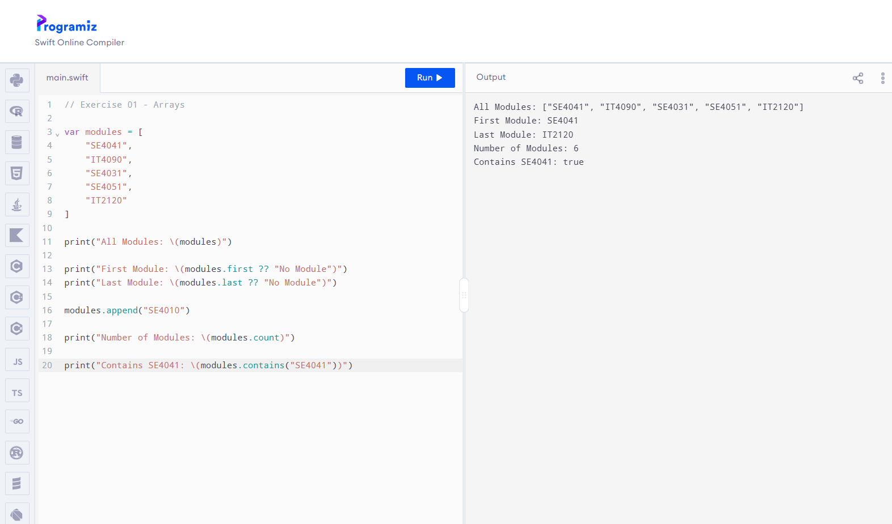
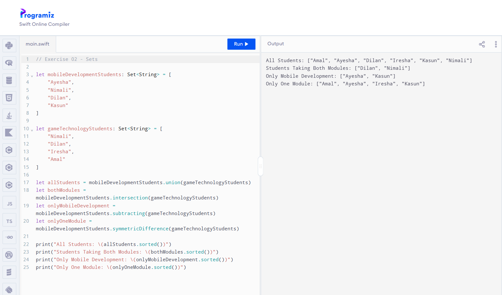
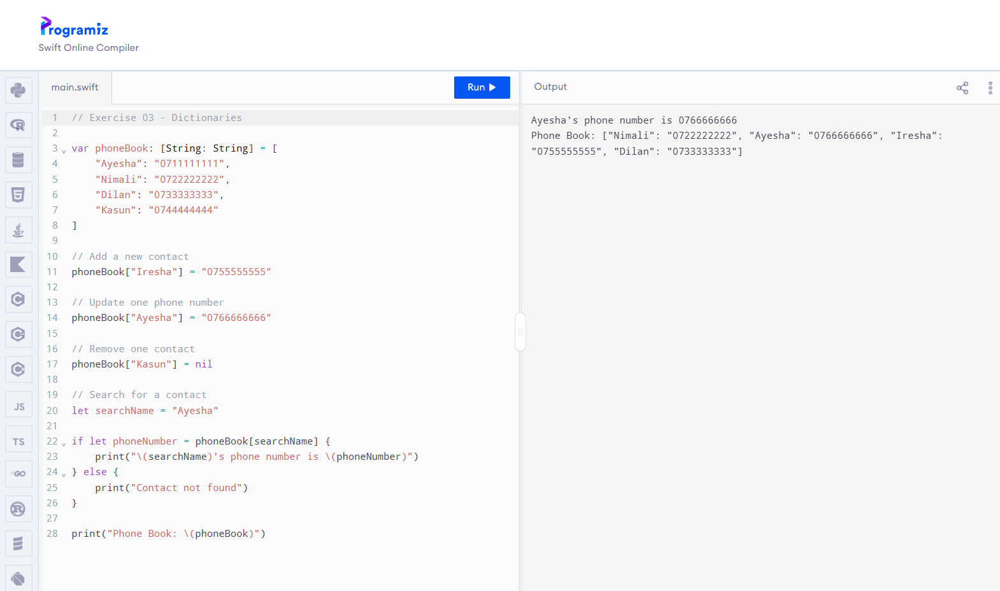

# SE4041 Practical 02

**Student Name:** Ayesha Amarawardhane  
**Student ID:** IT22237804  
**Module:** SE4041 – Mobile Application Design and Development  
**Practical:** Collections & Control Flow in Swift  
**Environment Used:** Programiz Swift Online Compiler

## Completed Files

- Exercise01.swift
- Exercise02.swift
- Exercise03.swift
- Exercise04.swift
- Exercise05.swift
- Exercise06.swift
- FinalChallenge.swift

## Topics Covered

- Arrays
- Sets
- Dictionaries
- if / else if / else
- switch statements
- Ranges
- for-in loops
- while and repeat-while loops
- break and continue

## Final Practical Task

### Student Performance Manager

The program:

- Stores student marks using a dictionary
- Displays student marks and grades
- Calculates grades using switch statements and ranges
- Stores passed students in an array
- Stores unique grades in a set
- Calculates the class average
- Displays the highest and lowest marks

## Practical Evidence

### Exercise 01

### Exercise 02

### Exercise 03

